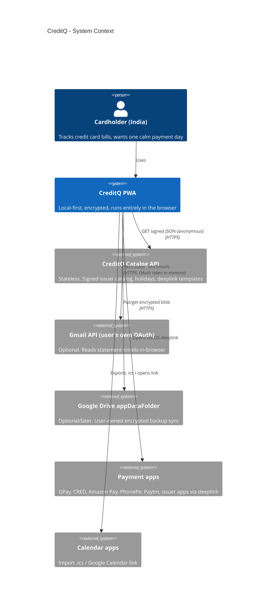
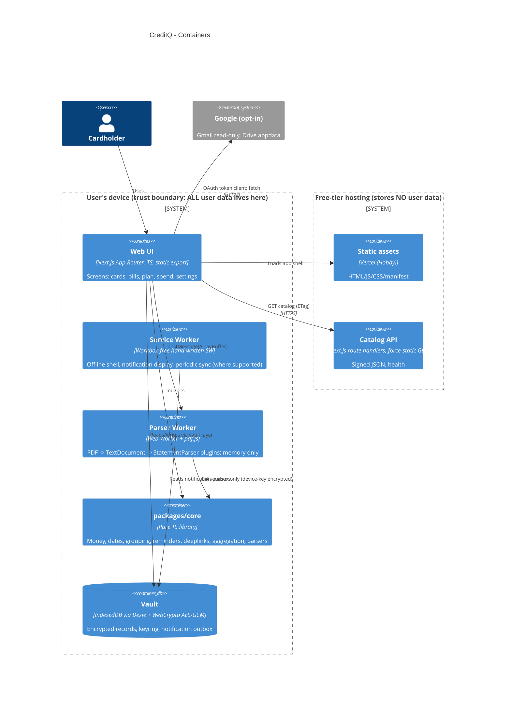

# 00 - Overview: CreditQ (short for Credit Queue)

Status: Draft v1 for manager review. Date: 2026-11-06.
Convention: anything not given by the manager and not verifiable offline is labelled **ASSUMPTION**. Version numbers are "latest stable at M0, then pinned" unless stated.

## 1. Goals

0. **Reminders are the primary product.** Intake is a 2-step manual add-card flow (issuer, last 4, optional nickname and colour; then the due date or statement day + due-offset). **Amounts are not collected up front**: the only user-entered amount is the optional field in the 'Mark as paid' sheet, and the spend dashboard reflects only what the user logged. PDF/Gmail plugins are the only place amounts may later be auto-filled. PDF upload is an optional secondary plugin (M2); Gmail intake is post-v1. No autopay/NACH modelling. Delivery is layered: .ics with VALARM first, then in-app banners, then service-worker notifications (best effort); an optional push relay is an open question.
1. Users add credit cards and always know what is due and when, without opening the app: the app schedules reminders for them.
2. **Grouped payment days**: compute one common, safe payment day for several bills with nearby due dates (details: `03-grouping-algorithm.md`), and remind once.
3. A minimal "Open my payment app" button (one preferred app chosen once; it only opens the app or issuer pay page: no amount, no clipboard, no prefill).
4. Per-card and cumulative monthly dashboard built from the payments the user chose to log in 'Mark as paid' (not from statements).
5. Privacy by architecture: the developer/server cannot see user financial data because it never leaves the device.
6. Total running cost: $0 (free tiers only), see `06-testing-ci-cost.md`.

Default reminder timing: 5 days before the group's earliest due date (1-10, per-user and per-card), rolled EARLIER over weekends/bank holidays, with follow-ups at 2 days before and on the due day if unpaid (`03`).

## 2. Non-goals (v1)

- No moving money. We never initiate or process payments; deeplinks only open other apps.
- No server-side accounts, no login to CreditQ, no server-side sync, no analytics/telemetry, no crash reporters that transmit data.
- No Account Aggregator / bank API integrations, no SMS reading (not possible in a PWA anyway).
- No credit score, offers, card recommendations, ads.
- No non-INR, non-India support. Loans/utility bills are out of scope (data model leaves room: `Bill.kind`).
- Not a native app (PWA only). A TWA wrapper for Play Store is a post-M4 option.
- No autopay/NACH handling or state. No multi-app deeplink sheet or prefill promises.
- No remote push (Web Push needs a subscription server that would learn the schedule). See open question Q4.

## 3. Principles (privacy by architecture)

| #   | Principle                                                          | Consequence in design                                                                                                        |
| --- | ------------------------------------------------------------------ | ---------------------------------------------------------------------------------------------------------------------------- |
| P1  | Data never leaves the device unless the user explicitly exports it | No API endpoint accepts user data. API is GET-only.                                                                          |
| P2  | The server is incapable of learning, not merely promising          | Stateless handlers, no DB, no logging of IP/UA beyond what the CDN does by default; no cookies; no request bodies.           |
| P3  | Encrypted at rest on device                                        | Vault envelope (AES-GCM) with passphrase/passkey-derived key (`01`).                                                         |
| P4  | Remote data is untrusted until signed                              | Catalog JSON is signed (Ed25519) at build time; client verifies with pinned keys. Remote content is data only, never code.   |
| P5  | Pure domain core                                                   | `packages/core` has no DOM, no IO, no clock; deterministic, property-testable.                                               |
| P6  | Minimal third-party surface                                        | No analytics, no CDN scripts, no fonts from third parties; Google only on explicit opt-in (Gmail, Drive) on isolated routes. |
| P7  | Fail safe on money-timing                                          | When uncertain (holiday, lag, missing bill) choose the earlier payment day and say why.                                      |
| P8  | Honest limits                                                      | We document what a PWA cannot do (iOS background, push) rather than faking it.                                               |

## 4. C4 Level 1: System context



## 5. C4 Level 2: Containers



Trust boundary rule: arrows leaving the "device" boundary carry only (a) anonymous catalog GETs, (b) opt-in Google traffic that goes directly from browser to Google, never through our API.

## 6. Tech stack and hosting

| Concern         | Choice                                                                                                                               | Why                                                                                                                                                                                                                                      | Free-tier note                                                          |
| --------------- | ------------------------------------------------------------------------------------------------------------------------------------ | ---------------------------------------------------------------------------------------------------------------------------------------------------------------------------------------------------------------------------------------- | ----------------------------------------------------------------------- |
| Framework       | Next.js (App Router), TypeScript strict                                                                                              | Mandated                                                                                                                                                                                                                                 | `output: 'export'` for web app (fully static; no server runtime needed) |
| PWA             | Hand-written SW + `manifest.webmanifest` (Serwist as fallback option)                                                                | App Router SSG + minimal SW we fully control (notification logic must be exact)                                                                                                                                                          | n/a                                                                     |
| UI              | shadcn/ui + Tailwind (ASSUMPTION; UI-lib-agnostic: all screens depend on `packages/ui-contracts` view-model hooks, not components)   | Copy-in components, no runtime dep, a11y via Radix                                                                                                                                                                                       | n/a                                                                     |
| Local DB        | Dexie 4 over IndexedDB                                                                                                               | Typed, migrations, liveQuery                                                                                                                                                                                                             | n/a                                                                     |
| Crypto          | WebCrypto (AES-GCM, PBKDF2/HKDF, WebAuthn PRF optional); `@noble/ed25519` fallback for signature verification                        | No JS crypto in the hot path; native                                                                                                                                                                                                     | n/a                                                                     |
| PDF             | `pdfjs-dist` in a dedicated Worker                                                                                                   | Mandated                                                                                                                                                                                                                                 | n/a                                                                     |
| Validation      | zod (catalog, import files, parser output)                                                                                           | One schema source for TS types + runtime checks                                                                                                                                                                                          | n/a                                                                     |
| State           | Zustand + Dexie `liveQuery`                                                                                                          | Small, no server cache                                                                                                                                                                                                                   | n/a                                                                     |
| API             | Next.js route handlers, `dynamic = 'force-static'`, GET only                                                                         | Mandated, effectively static JSON                                                                                                                                                                                                        | See hosting                                                             |
| Hosting         | **Vercel Hobby** (manager decision): web app and API as two Vercel projects from the same repo                                       | Native Next.js support, preview deploys per PR, headers (CSP/cache) via `vercel.json` / `next.config` `headers()`. **Licence caveat**: Hobby is for personal, non-commercial use under Vercel's terms; see migration path below and `06` | $0 on `*.vercel.app`; custom domain optional (not counted)              |
| Lint            | ESLint 9 flat config + **`eslint-config-airbnb-extended`** + `typescript-eslint` + `eslint-config-prettier`; Prettier run separately | See section 8                                                                                                                                                                                                                            | n/a                                                                     |
| Tests           | Vitest, fast-check, Playwright, axe, Lighthouse CI                                                                                   | `06`                                                                                                                                                                                                                                     | GitHub Actions free                                                     |
| Monorepo        | pnpm workspaces + Turborepo (local cache only)                                                                                       | Fast, free                                                                                                                                                                                                                               | No remote cache                                                         |
| Release signing | Ed25519 private key in GitHub Actions encrypted secret; signs catalog at build                                                       | No signing runtime on the server                                                                                                                                                                                                         | n/a                                                                     |

Why two Vercel projects (web + api) rather than one Next app? The API has no access to, and no knowledge of, any user code path; the web app contains no server code. Privacy claims become auditable per project (web: zero route handlers; api: zero client code), the web app's CSP `connect-src` names exactly one API origin, and the API can be redeployed (catalog refresh) without shipping a new app version. The cost is one extra Vercel project (still $0). They can be collapsed later without contract changes.

### 6.1 Hosting migration path (if ever monetised)

Vercel Hobby may not be used for commercial purposes (ads, paid tiers, donations-as-revenue are all grey/red areas; ASSUMPTION: re-read Vercel's terms at launch). Because the web app is a pure static export and the API is `force-static` GET JSON, migration is mechanical: (1) **Cloudflare Pages** (free, static, `_headers` file replaces `vercel.json` headers; API as a static JSON build or via the OpenNext adapter), or Netlify/GitHub Pages for the web app; (2) or upgrade to Vercel Pro (paid, breaks the $0 rule). Keep hosting-specific config isolated in two files (`vercel.json` and a generated `_headers` produced by the same script) so a switch is a DNS change. Open question Q6 asks the manager to confirm the monetisation intent.

## 7. Repo structure

```
creditq/                   # repo name: creditq (pnpm workspace; packages are @creditq/*)
  apps/
    web/                    # Next.js PWA (static export). No route handlers.
      src/app/              # App Router routes: /, /cards, /bills, /plan, /spend, /settings, /import, /connect/gmail
      src/features/         # feature modules (cards, bills, plan, spend, import, backup, onboarding)
      src/workers/          # pdf-parser.worker.ts, crypto.worker.ts (KDF off main thread)
      src/sw/               # service worker source (built to /sw.js)
      public/               # manifest, icons
      vercel.headers.json   # CSP etc.; script hashes injected post-build into vercel.json
    api/                    # Next.js route handlers only, force-static GET
      src/app/api/v1/...
  packages/
    core/                   # PURE TS, zero runtime deps except zod types: money, civil-date, calendar,
                            #   grouping, reminders (planner + ics + notif payload), deeplink resolver,
                            #   spend aggregator, parsers (rules interpreter + issuer plugins)
    catalog/                # source-of-truth JSON (issuers, holidays, deeplinks, parser rule packs),
                            #   zod schemas, build+sign+verify scripts, key ids
    vault/                  # client-only: Dexie schema, encryption envelope, keyring, migrations, backup format
    ui-contracts/           # UI-library-agnostic view-model hooks and prop types (swap shadcn/OAT freely)
    testkit/                # synthetic statement generator (pdf-lib), fake clock, fast-check arbitraries
    config/                 # eslint, prettier, tsconfig bases, vitest base
  docs/system-design/
  .github/workflows/        # ci.yml, catalog-publish.yml, e2e.yml
  turbo.json  pnpm-workspace.yaml
```

Dependency rules (enforced by `eslint-plugin-import` boundaries or `dependency-cruiser` in CI):

- `core` imports nothing from other packages except `catalog` _types_.
- `vault` imports `core` types only. `apps/web` may import everything. `apps/api` imports `catalog` only.
- Nothing in `core` may reference `window`, `document`, `indexedDB`, `Date.now()`, `Intl` locale-dependent APIs (lint rule: `no-restricted-globals`/`no-restricted-properties`).

## 8. Lint decision (researched assumption, verify in M0 spike)

- `eslint-config-airbnb-typescript` is effectively end-of-life: it targets ESLint 8 / legacy eslintrc and does not support flat config. Do not use it.
- Recommended in 2026: **`eslint-config-airbnb-extended`** (community successor, flat-config native, ESLint 9, includes TypeScript rule sets and a Node/React/Next presets), plus `typescript-eslint` parser/plugin, `@next/eslint-plugin-next`, `eslint-plugin-jsx-a11y`, `eslint-plugin-import-x`, `eslint-config-prettier` (disables stylistic conflicts). Prettier runs as a separate `prettier --check` step (not `eslint-plugin-prettier`: faster, fewer false positives).
- **ASSUMPTION**: it supports the then-current ESLint major. M0 acceptance includes a spike: if it does not, fall back to `@eslint/eslintrc` `FlatCompat` wrapping `eslint-config-airbnb` + `eslint-config-airbnb-base` with `typescript-eslint` overrides, pinned to ESLint 9.
- Project overrides we expect: allow `import/prefer-default-export` off, `no-restricted-syntax` relaxed for `for...of` in `core` (Airbnb forbids it; we allow it as it is faster than iterator helpers on hot paths), `no-plusplus` off in loops. Every override carries a comment.

## 9. Document map

| File                                     | Content                                                             |
| ---------------------------------------- | ------------------------------------------------------------------- |
| `01-data-model.md`                       | Local schema, encryption, migrations                                |
| `02-api-contracts.md`                    | Stateless API + core module interfaces + threat model of the server |
| `03-grouping-algorithm.md`               | Grouped payment day                                                 |
| `04-reminder-and-notification-design.md` | .ics, notifications, limits                                         |
| `05-security-and-privacy.md`             | CSP, Gmail, DPDP                                                    |
| `06-testing-ci-cost.md`                  | Tests, CI, cost proof                                               |
| `07-roadmap.md`                          | M0-M4, open questions                                               |

## 10. Package naming

npm scope `@creditq/*`: `@creditq/core`, `@creditq/catalog`, `@creditq/vault`, `@creditq/ui-contracts`, `@creditq/testkit`, `@creditq/config`; apps `@creditq/web`, `@creditq/api`. Repo: `creditq`. Catalog/ICS UID domain: `creditq.invalid` until a real domain exists.
