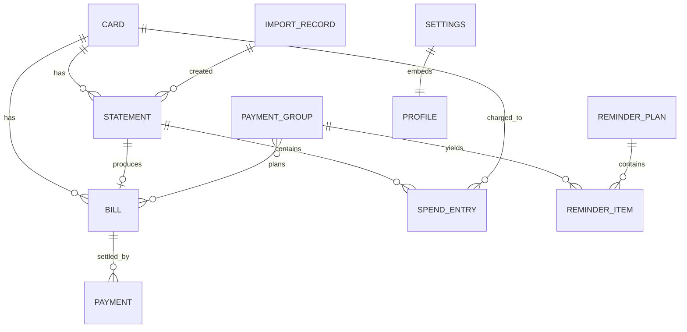
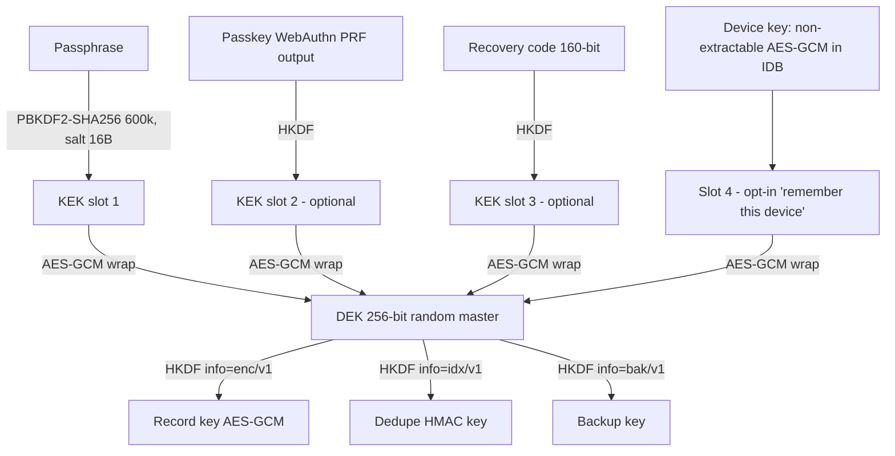

# 01 - Data Model, Encryption, Migrations

All of this lives in the user's browser. Package: `packages/vault` (storage, crypto) and `packages/core` (types, pure logic).

## 1. Fundamental conventions

| Topic           | Decision                                                                                                                                                                                                                                                                                                                                |
| --------------- | --------------------------------------------------------------------------------------------------------------------------------------------------------------------------------------------------------------------------------------------------------------------------------------------------------------------------------------- |
| IDs             | ULID strings generated client-side (sortable, no coordination). Branded types.                                                                                                                                                                                                                                                          |
| Money           | **Integer paise** as `number` (safe to 9e15 paise, i.e. far beyond any card limit). Branded `Paise`. No floats anywhere in core. Parsing "1,23,456.78" is done by a string parser into paise; formatting uses a hand-written Indian-grouping formatter (not `Intl`, to be deterministic across browsers). Refunds/credits are negative. |
| Civil dates     | `CivilDate = 'YYYY-MM-DD'` string (branded) meaning a calendar date in India. Used for statement date, due date, txn date, pay day.                                                                                                                                                                                                     |
| Instants        | `EpochMs` (UTC ms) only for `createdAt/updatedAt/fireAt`.                                                                                                                                                                                                                                                                               |
| Timezone        | IST is a fixed UTC+05:30 with no DST, so no tz database is needed. Conversion `civil + 'HH:mm' -> EpochMs` is `Date.UTC(y,m-1,d,H,M) - 19_800_000`. All reminders are expressed in IST regardless of device timezone (a traveller still gets "10:00 IST"; setting `reminderTimeZoneMode: 'ist'                                          | 'device'`, default `ist`). "Today" is derived from an injected `Clock`as`civilFromEpoch(now + 19_800_000)`. |
| Deletes         | Soft delete (`deletedAt`) for user-visible undo for 30 days, then physical purge job. "Delete all data" is physical (see secure deletion in `05`).                                                                                                                                                                                      |
| Schema versions | Every encrypted payload carries `v` (payload schema version). Dexie version only changes for index changes.                                                                                                                                                                                                                             |

## 2. What is deliberately NOT stored

- Full card number (PAN), CVV/CVC, expiry date, PIN, OTP, net-banking credentials, UPI PIN. The UI has no field for them and import parsers **redact** any 13-19 digit run (Luhn-valid or not) before producing output; the parser output type has no PAN field. A test (`06`) asserts that no stored record or backup contains a Luhn-valid 13-19 digit string.
- Stored for a card: `last4`, `network`, `issuerId`, optional `nickname`, `variant` (e.g. "Regalia"), `billingDayHint`.
- Raw statement PDFs and raw emails: **never persisted** (memory only; see `05`). Only extracted facts (`Statement`, `SpendEntry`) are kept, plus a keyed hash of the file to detect re-imports.
- Full merchant payloads from statements beyond `description` (as printed), no addresses, no reward-point detail beyond an optional integer.
- Bill and statement amounts are **not collected** by manual intake; the only user-entered amount is `Payment.amountPaise`, captured in the optional 'Mark as paid' sheet (Skip allowed).
- Passphrase: never stored. Gmail refresh tokens: none exist (token model, in-memory access token only; see `05`).
- User name / DOB parts used for PDF passwords: stored encrypted in `Settings.profile` only if the user opts in ("remember PDF password pieces"), otherwise asked each import.

## 3. Entity relationship



## 4. TypeScript types (contracts, `packages/core/src/model`)

```ts
// ---------- primitives ----------
declare const brand: unique symbol;
type Brand<T, B extends string> = T & { readonly [brand]: B };

export type Paise = Brand<number, 'Paise'>; // integer, may be negative
export type CivilDate = Brand<string, 'CivilDate'>; // 'YYYY-MM-DD' (IST calendar date)
export type EpochMs = Brand<number, 'EpochMs'>;
export type Ulid = Brand<string, 'Ulid'>;
export type CardId = Brand<string, 'CardId'>;
export type BillId = Brand<string, 'BillId'>;
export type IssuerId = Brand<string, 'IssuerId'>; // catalog key, e.g. 'hdfc'
export type IsoWeekday = 1 | 2 | 3 | 4 | 5 | 6 | 7; // 1 = Monday ... 7 = Sunday

export type Network = 'visa' | 'mastercard' | 'rupay' | 'amex' | 'diners' | 'unknown';

interface Base {
  id: Ulid;
  v: number; // payload schema version (for lazy migration)
  createdAt: EpochMs;
  updatedAt: EpochMs;
  deletedAt?: EpochMs;
}

// ---------- Card ----------
export interface Card extends Base {
  id: CardId;
  issuerId: IssuerId; // from catalog; 'other' allowed
  issuerNameOverride?: string; // when issuerId = 'other'
  network: Network;
  last4: string; // exactly 4 digits, validated; NEVER more
  nickname?: string;
  variant?: string;
  status: 'active' | 'closed';
  // PRIMARY INTAKE = a 2-step add-card flow (manager decision, amounts are NOT collected):
  //   step 1: issuer, last4, optional nickname, optional colour/style
  //   step 2: the due date, OR statement day + due-offset
  // No amount due / minimum due is asked for at card creation or shown in the Pay-day UI.
  // Cycle knowledge (drives the first Bill and projection of future bills)
  cycle: {
    nextDueDate?: CivilDate; // step 2, option A: the upcoming due date; creates the first Bill
    statementDay?: number; // 1..31 typical statement generation day
    dueDay?: number; // 1..31 typical due day-of-month
    dueOffsetDays?: number; // alternative: due = statementDate + N (issuer rule)
  };
  // NOTE (manager decision): no autopay/NACH state exists anywhere in the model. Every bill is a manual-pay bill.
  groupPrefs: {
    excludeFromGrouping?: boolean;
    leadDays?: number; // per-card override of Settings.grouping.leadDays (1..10)
    payMethod?: PayMethod; // typical method, controls posting lag
  };
  limit?: Paise; // optional, for utilisation display
  style?: { colorToken: string; pattern?: 'solid' | 'gradient' | 'stripe' }; // optional card colour/style, purely cosmetic
}
export type PayMethod =
  'upi' | 'netbanking' | 'debit_card' | 'neft_imps' | 'issuer_app' | 'cred' | 'other';
export type PayApp = 'gpay' | 'cred' | 'amazonpay' | 'phonepe' | 'paytm' | 'issuer';

// ---------- Statement (PLUGIN-ONLY: the ONLY place statement amounts may be auto-filled) ----------
// Manual intake never creates Statements and never asks for amounts. Statement/SpendEntry/ImportRecord tables exist in the
// schema but are populated only by optional intake plugins (PDF = M2/M3, Gmail = post-v1). Amounts here are not shown in the Pay-day UI.
export interface Statement extends Base {
  cardId: CardId;
  importId?: ImportId;
  periodStart: CivilDate;
  periodEnd: CivilDate;
  statementDate: CivilDate;
  dueDate: CivilDate;
  totalDue: Paise;
  minDue: Paise;
  previousBalance?: Paise;
  paymentsReceived?: Paise;
  newCharges?: Paise;
  creditLimit?: Paise;
  rewardPoints?: number;
  source: 'pdf' | 'gmail';
  parser?: { issuerId: IssuerId; parserId: string; version: string; confidence: number };
  fieldConfidence?: Partial<Record<'dueDate' | 'totalDue' | 'minDue' | 'statementDate', number>>;
  userVerified: boolean; // user confirmed the extracted values on the review screen
}

// ---------- Bill (a due date to act on; carries NO required amount) ----------
export type BillStatus =
  | 'projected' // inferred from card cycle; no concrete due date confirmed yet. Low confidence.
  | 'open'
  | 'paid' // user tapped 'Mark as paid' (amount may be skipped)
  | 'overdue' // derived on tick: open and dueDate < today
  | 'void';
// No 'partial' / 'min_paid' states: without collected amounts the app cannot know them. A bill is simply paid or not.

export interface Bill extends Base {
  id: BillId;
  cardId: CardId;
  kind: 'card'; // extension point for loans/utilities
  statementId?: Ulid; // only when created by an intake plugin
  dueDate: CivilDate; // the ONLY financial-timing input the grouping engine needs
  statementDate?: CivilDate; // earliest day we may pay (lower bound `lo`, see 03); optional
  status: BillStatus;
  confidence: 'projected' | 'manual' | 'plugin';
  // Optional, PLUGIN-ONLY (PDF/Gmail) auto-filled hints. Never collected manually, never shown in the Pay-day UI,
  // never used by grouping or reminder text. Absent for all manually created bills.
  pluginAmounts?: { totalDue?: Paise; minDue?: Paise; source: 'pdf' | 'gmail' };
  paymentId?: Ulid; // set when marked paid
  groupId?: Ulid; // current PaymentGroup
  pinnedPayDay?: CivilDate; // user override, group engine must respect
  note?: string;
}

// ---------- Payment (created ONLY by 'Mark as paid'; the sole place a user-entered amount is captured) ----------
// 'Mark as paid' opens a small sheet: numeric amount field, 'Skip' allowed (amountPaise = null).
export interface Payment extends Base {
  billId: BillId; // bill reference
  cardId: CardId;
  amountPaise: Paise | null; // null when the user skipped; never inferred by the app
  paidAt: EpochMs; // instant the user tapped 'Mark as paid' (or edited it)
  paidOn: CivilDate; // IST civil date of paidAt; the dashboard month bucket uses this
  method?: PayMethod;
  source: 'user_marked' | 'plugin_detected'; // plugin_detected: statement says payment received (plugins only)
  groupId?: Ulid; // marking a group paid creates one Payment per bill (amount per bill, or null)
}
// Invariant: at most one non-deleted Payment per Bill (editing replaces amount/paidAt). Undo = soft delete + bill back to 'open'.

// ---------- SpendEntry (PLUGIN-ONLY statement line item; absent in a manual-only install) ----------
export interface SpendEntry extends Base {
  cardId: CardId;
  statementId?: Ulid;
  txnDate: CivilDate;
  postedDate?: CivilDate;
  amount: Paise; // INR; debit positive, refund/credit negative
  kind:
    | 'purchase'
    | 'refund'
    | 'fee'
    | 'interest'
    | 'emi'
    | 'cash_advance'
    | 'payment'
    | 'reversal'
    | 'other';
  description: string; // as printed, PAN-redacted
  merchant?: string; // normalised by local rules
  categoryId?: CategoryId; // local categoriser or user override
  categorySource: 'rule' | 'user' | 'none';
  foreign?: { currency: string; minor: number }; // informational only
  periodKey: string; // 'YYYY-MM' of txnDate (calendar month)
  dedupeKey: string; // HMAC-SHA256(dedupeSubkey, cardId|txnDate|amount|descNorm|ordinal) hex, truncated 16B
  manual: boolean;
}
export type CategoryId = Brand<string, 'CategoryId'>;
// v1 spend dashboard is built from Payment.amountPaise (what the user logged). SpendEntry, when present (plugins),
// is an additional detail source; aggregation excludes kind === 'payment' and treats refunds as negative spend.

// ---------- PaymentGroup (persisted result of GroupingEngine) ----------
export interface PaymentGroup extends Base {
  payDay: CivilDate;
  billIds: BillId[];
  lastSafeDay: CivilDate; // hard cap: min over members of latest day money can still be credited safely
  earliestOkDay: CivilDate; // max lo over members
  source: 'auto' | 'user_pinned';
  status: 'planned' | 'paid' | 'partially_paid' | 'cancelled' | 'at_risk';
  inputsHash: string; // hash of everything the engine read; unchanged => keep group (stability)
  explanation: GroupExplanation; // persisted so UI can answer "why this day?"
}
export interface GroupExplanation {
  reasons: Array<{ code: string; params: Record<string, string | number> }>;
  warnings: Array<{ code: string; billId?: BillId }>;
}

// ---------- ReminderPlan (derived, persisted for idempotency) ----------
export interface ReminderPlan extends Base {
  planHash: string; // hash(groups, bills, settings.reminder, catalog.holidaysVersion)
  generatedFor: { from: CivilDate; to: CivilDate };
  items: ReminderItem[];
  seq: number; // monotonically increasing; becomes ICS SEQUENCE
}
export interface ReminderItem {
  itemId: string; // stable: hash(kind|sortedBillIds|localDate|localTime)
  kind:
    | 'pay_day'
    | 'followup_2d'
    | 'due_day'
    | 'heads_up'
    | 'overdue_nudge'
    | 'projected_check'
    | 'backup_nudge';
  escalationLevel: 0 | 1 | 2 | 3; // 0 pay_day (+optional heads_up), 1 followup_2d, 2 due_day, 3 overdue_nudge (see 04)
  snoozeUntil?: EpochMs; // user snooze; effective fire time = max(fireAt, snoozeUntil)
  snoozeCount?: number; // capped (default 3) so snooze cannot silently bury a bill
  acknowledgedAt?: EpochMs; // user tapped/opened it
  fireAt: EpochMs;
  localDate: CivilDate;
  localTime: string; // 'HH:mm' IST
  billIds: BillId[];
  groupId?: Ulid;
  conditional: 'always' | 'unless_paid'; // .ics can only express 'always'
  contentLevel: 'generic' | 'cards';
  state: 'pending' | 'shown' | 'dismissed' | 'suppressed_paid' | 'missed';
}

// ---------- Settings ----------
export interface Settings {
  key: 'settings';
  v: number;
  updatedAt: EpochMs;
  grouping: {
    enabled: boolean;
    leadDays: number; // DEFAULT 5, user range 1..10: reminder/pay day target = earliest due date in the group minus leadDays
    groupWindowDays: number; // default 7: bills whose due dates are within this many days of the group's earliest due date share one day
    safetyBufferDays: number; // default 1: hard guard; payDay is never later than (due - safetyBuffer - posting lag)
    postingLagBusinessDays: Record<PayMethod, number>; // defaults: upi 1, netbanking 1, debit_card 1, neft_imps 1, issuer_app 1, cred 1, other 2
    allowWeekendPayDay: boolean; // default false
    relyOnHolidayRollover: boolean; // default false (conservative)
    holidayState?: string; // ISO 3166-2:IN e.g. 'IN-MH'; default national only
    horizonDays: number; // default 45
  };
  reminders: {
    enabled: boolean;
    payDayTime: string; // 'HH:mm' default '10:00'
    headsUp: { enabled: boolean; time: string; businessDaysBefore: number }; // default 18:00, 1
    followUp2d: boolean; // default true: due - 2 days, 10:00, only if still unpaid
    dueDay: boolean; // default true, 09:00, only if still unpaid
    escalation: {
      // what happens if the user ignores (details in 04)
      overdueNudgeEveryDays: number; // default 1 for first 3 days after due, then every 3 days
      overdueNudgeMaxDays: number; // default 14, then stop and show persistent in-app banner only
      snoozeOptionsMinutes: number[]; // default [60, 240, 'tomorrow 10:00' handled in UI]
      maxSnoozes: number; // default 3 per item
    };
    icsAlarmMinutesBefore: number[]; // default [0, 720] on the pay_day event: at start + 12h earlier
    quietHours?: { from: string; to: string };
    contentLevel: 'generic' | 'cards'; // default 'cards'
    timeZoneMode: 'ist' | 'device';
  };
  security: {
    lockTimeoutSec: number; // default 300
    unlockMethods: Array<'passphrase' | 'passkey' | 'device'>;
    hideAmountsOnBlur: boolean;
  };
  profile?: { fullName?: string; dob?: string; panLast4?: string }; // optional, only for PDF password derivation. NOTE: panLast4 here is the user's PAN (tax id) last 4, not a card number; opt-in.
  ui: { theme: 'system' | 'light' | 'dark'; language: 'en' | 'hi' };
  backup: { lastExportAt?: EpochMs; nudgeEveryDays: number };
  preferredPayApp?: PayApp; // chosen ONCE; drives the single 'Open my payment app' button (no amount, no clipboard; see 02 B.4)
  gmail?: { connected: boolean; lastScanAt?: EpochMs; query?: string }; // POST-V1 optional plugin; absent in v1
  catalog: { lastCheckedAt?: EpochMs; version?: string };
}

// ---------- ImportRecord ----------
export type ImportId = Brand<string, 'ImportId'>;
export interface ImportRecord extends Base {
  id: ImportId;
  source: 'pdf' | 'gmail' | 'backup';
  fileHash: string; // HMAC-SHA256(dedupeSubkey, bytes) - detects re-import without storing file
  gmailMessageIdHash?: string; // HMAC of message id
  issuerId?: IssuerId;
  parser?: { parserId: string; version: string };
  outcome: 'ok' | 'needs_review' | 'failed' | 'duplicate';
  errorCode?: string; // from the closed ParseErrorCode enum; no content
  createdStatementIds: Ulid[];
  entriesCreated: number;
}
```

## 5. Dexie schema (plaintext index columns only)

Principle: the Dexie "table row" is `{ ...plaintextIndexFields, v, n, c }` where `n` = 12-byte nonce and `c` = AES-GCM ciphertext of the JSON of the full record (including the indexed fields, for integrity: on decrypt, indexed columns are compared to the decrypted values; mismatch = tamper error).

```ts
// packages/vault/src/schema.ts
export const DB_NAME = 'creditq';
db.version(1).stores({
  cards: 'id, status',
  statements: 'id, cardId, dueDate, [cardId+statementDate]',
  bills: 'id, cardId, dueDate, status, groupId, [cardId+dueDate]',
  payments: 'id, billId, cardId, paidOn',
  spend: 'id, cardId, statementId, txnDate, periodKey, [cardId+periodKey], dedupeKey',
  groups: 'id, payDay, status',
  reminderPlans: 'id',
  outbox: 'id, fireAt, state', // notification outbox + pending-actions queue (snooze/mark_paid from SW): device-key encrypted (NOT vault key), see 4.3
  imports: 'id, importedAt, fileHash',
  settings: 'key',
  keyring: 'id', // wrapped key slots (plaintext JSON, contains only wrapped keys + KDF params)
  catalogCache: 'key', // signed catalog bundle (public data, unencrypted)
  meta: 'key', // schema/payload versions, lastBackupAt, installId (random, local only)
});
```

Plaintext leakage accepted and documented: row counts, `cardId` (random ULID), due dates, statement dates, txn dates / month buckets, bill status, `fireAt`. Rationale: indexed range queries (`dueDate` window, month aggregation) need them, and they are low-sensitivity compared to amounts, merchants, last4, nicknames, issuer, which are inside ciphertext. `dedupeKey`/`fileHash` are HMACs so they reveal nothing without the key. **Honest limit**: someone with disk access learns "this person has ~N card bills, due around these dates". If the user selects "Maximum privacy" (settings, post-v1), the vault switches to _blob mode_: all dates encrypted, whole tables decrypted into memory at unlock and indexed in memory (feasible: <100k rows). The record codec is the same; only the index extractor differs (`indexFields(record) => {}`).

### 5.1 Cardinality estimates (ASSUMPTION)

Power user: 8 cards x 12 months x 80 txns = ~8k spend rows/year, ~40k over 5 years. Decrypt-all-at-unlock is ~ 40k AES-GCM ops of ~300 B: tens of ms in WebCrypto batches. So even indexed mode loads hot windows lazily but never needs pagination for correctness.

## 6. Encryption envelope

### 6.1 Key hierarchy



- **DEK** generated once by `crypto.getRandomValues(32)`; imported as non-extractable `CryptoKey` after unlock; only the wrapped form is persisted (`keyring`). Changing passphrase rewraps the DEK only (O(1)); no data rewrite.
- **KDF**: PBKDF2-HMAC-SHA256, 600,000 iterations (OWASP 2023 guidance), 16-byte random salt, executed in a worker to keep UI responsive. Parameters stored with each slot (`kdf: {alg:'pbkdf2-sha256', iter, salt}`) so we can add `argon2id` (WASM, M4) without breaking existing vaults; iteration count is re-benchmarked on device creation and bumped on next unlock if below target.
- **Passphrase policy**: min 10 chars or 4+ word passphrase suggestion; zxcvbn-lite strength meter (local); hard fail below threshold. Rate limiting is local only and cosmetic (offline brute force is the real threat; PBKDF2 + strong passphrase is the defence).
- **Passkey slot (optional, M4)**: WebAuthn `prf` extension yields a stable secret per credential; HKDF -> KEK. Supported in current Chrome/Safari/Edge; feature-detect, hide if unsupported. A passkey alone is never the only slot unless the user also saves a recovery code.
- **Record encryption**: AES-256-GCM, random 96-bit nonce per record write, AAD = `"creditq/v1|" + table + "|" + id + "|" + payloadVersion`. AAD prevents moving ciphertext between rows/tables. Random nonces are safe to ~2^32 writes per key; we enforce a write counter in `meta` and rotate the DEK (re-encrypt all) at 2^30.
- **Notification outbox** (`outbox` table) is encrypted with the _device key_ (non-extractable, generated at install, stored in IDB as a `CryptoKey`) so the service worker can decrypt and show a reminder while the vault is locked. It only contains `contentLevel`-limited text ("2 card bills to pay today" by default; card nicknames only if the user selected `cards`). It never holds amounts at all (the app does not collect amounts up front, and notification text has no amount field). Honest limit: anyone who can run script on the origin or read the browser profile on the live OS user can read the outbox; this only defends against casual disk/backup inspection and against exfiltration via export files (the outbox is never exported).

### 6.2 Keyring record

```ts
export interface KeyringRecord {
  id: 'primary';
  formatVersion: 1;
  slots: Array<{
    slotId: Ulid;
    type: 'passphrase' | 'passkey' | 'recovery' | 'device';
    kdf?:
      | { alg: 'pbkdf2-sha256'; iter: number; salt: string /* b64 */ }
      | { alg: 'hkdf-sha256'; salt: string };
    credentialId?: string; // passkey
    wrappedDek: { n: string; c: string }; // AES-GCM(KEK, DEK), AAD='keyring|'+slotId
    createdAt: EpochMs;
  }>;
  verifier: { n: string; c: string }; // AES-GCM(DEK-derived, 'creditq-ok') for quick wrong-passphrase detection
}
```

### 6.3 Unlock/lock flow

Unlock -> derive KEK -> unwrap DEK -> import as non-extractable CryptoKey held in a module-scoped variable (not in storage, not in React state/devtools-visible store) -> subscribe to idle timer and `visibilitychange` (lock after `lockTimeoutSec` hidden). Lock = drop key references and clear in-memory decrypted caches. The service worker never gets the DEK.

### 6.4 Recovery story (honest)

- Forgot passphrase and no recovery code and no backup: **data is unrecoverable by design**. Said plainly at setup, with a typed acknowledgement.
- Mitigations: (1) 20-character recovery code shown once at setup (base32, 100 bits+ entropy; user prints/saves it); (2) encrypted backup file export with periodic nudges (`backup.nudgeEveryDays`, default 30); (3) optional Drive appDataFolder encrypted backup (later); (4) because bills can be re-imported from statements/emails, worst-case recovery is re-onboarding, not loss of the real obligation.
- Browser eviction: call `navigator.storage.persist()` at first successful setup; surface result. Safari ITP can delete script-written storage after ~7 days of non-use for non-installed sites; installed PWAs are exempt. UI warns on iOS non-installed.

### 6.5 Backup/export format

`*.creditq` file = JSON header + AES-GCM ciphertext:

```ts
interface BackupFile {
  magic: 'BILLCALM-BACKUP';
  formatVersion: 1;
  createdAt: EpochMs;
  appVersion: string;
  payloadSchemaVersions: Record<string, number>;
  kdf: { alg: 'pbkdf2-sha256'; iter: number; salt: string }; // separate backup password (may equal passphrase; user's choice)
  n: string; // nonce
  c: string; // AES-GCM(backupKey, gzip(JSON of all tables decrypted, excluding keyring/outbox/catalogCache))
  checksum: string; // SHA-256 of ciphertext for corruption detection
}
```

Backups are decrypted-then-re-encrypted under a backup-specific key so they are portable to a new device (the DEK is not). Import validates with zod, then offers merge (by id + `updatedAt` last-write-wins) or replace. Unencrypted export (CSV of spend only, user-initiated, with warning) is separate and never contains the vault.

## 7. Migrations

Two layers:

1. **Dexie version bumps** (`db.version(n).stores(...)`) only for index/table changes. Index changes never need decryption, so they run without the key and are safe at any app start. Each bump has a test that opens a fixture DB at version n-1 and checks it upgrades.
2. **Payload migrations** (`v` field): pure functions in `packages/core/src/model/migrations.ts`: `migrate_Card_1_to_2(old): New`. Applied **lazily on read** (after unlock) and persisted on next write; plus an explicit "migrate all" step after unlock when the app version changes, wrapped in one Dexie transaction per table. Before any bulk payload migration, the app writes an automatic in-memory snapshot and offers/forces a backup export (configurable) so a migration bug is recoverable.
   Rules: migrations are additive-first (new optional fields), never delete data in the same release that stops reading it, and every migration has a golden fixture in `packages/vault/test/fixtures/v{n}`. Downgrade is unsupported: if stored `v` > code's max, the app opens read-only with a "update the app" banner (relevant because PWA caches can lag).

## 8. Derived vs stored

| Data                        | Stored?                                              | Reason                                                                    |
| --------------------------- | ---------------------------------------------------- | ------------------------------------------------------------------------- |
| Spend totals per month/card | No (computed by SpendAggregator, memoised in memory) | Always consistent with entries                                            |
| PaymentGroup                | Yes                                                  | Stability + user pins + explanations                                      |
| ReminderPlan/outbox         | Yes                                                  | Idempotent scheduling, SW access                                          |
| Bill.status                 | Yes                                                  | 'paid' set/cleared only by Payment create/undo; 'overdue' derived at tick |
| Holiday calendar            | `catalogCache` (public)                              | Offline correctness                                                       |
