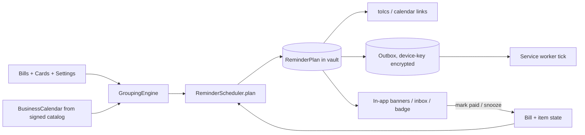
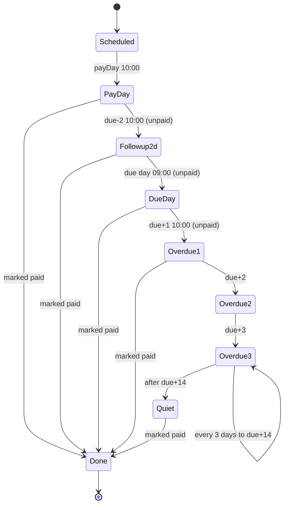

# 04 - Reminder and Notification Design (the primary product)

Reminders are the product. The app's job is that the user never has to look at a bill. Because a PWA cannot guarantee background delivery, delivery is **layered**, with the most reliable (OS calendar) first.

## 1. Delivery layers (in priority order)

| Layer | Mechanism | Works when app is closed? | Reliability | Platform notes |
|-------|-----------|---------------------------|-------------|----------------|
| L1 | **.ics with VALARM** (and Google Calendar links), imported into the user's calendar app | Yes, fully OS-driven, even offline, even if the app is never opened again | High (this is the backbone) | Apple Calendar honours VALARM. **Google Calendar ignores VALARM on imported files** and applies the user's default notification settings; we say so in the export UI. Samsung/Outlook vary. |
| L2 | **In-app banners / inbox / badge** | No, shown on open | Certain, but only when opened | Everywhere. Uses Badging API where available |
| L3 | **Service worker notifications**, best effort | Only if the SW gets woken | Low to medium | Chrome/Edge Android installed PWA: `periodicsync` (engagement-gated, ~12 h granularity, not guaranteed) plus opportunistic ticks. Desktop Chrome: only while running. iOS: see section 8 |
| L4 | (Open question) optional push relay | Yes | High | Needs a sender and storage; not a requirement (section 9) |

Facts that shape this (researched by manager): **Notification Triggers (`showTrigger`/TimestampTrigger) is dead**: it was only ever an origin trial and was removed, so we never depend on scheduled local notifications. iOS Web Push requires the PWA to be installed to the Home Screen *and* a push sender.

## 2. Single source of truth: ReminderPlan

All three layers (ICS, banners, notifications) are projections of one pure `ReminderPlan` (`ReminderScheduler.plan`, types in `01`/`02`). Never compute dates in a view.



### 2.1 Item generation (per group G with payDay P, per bill i in G)

| Kind | Date | Time (IST default) | Condition |
|------|------|--------------------|-----------|
| `pay_day` (group-level, one per group) | `P` | 10:00 | any member unpaid |
| `followup_2d` (per bill; coalesced by date) | `rollEarlier(due_i - 2)`; dropped if `<= P` or in the past | 10:00 | bill unpaid |
| `due_day` (per bill; coalesced by date) | `due_i` (not rolled) | 09:00 | bill unpaid |
| `overdue_nudge` (generated lazily, section 5) | `due_i + 1, +2, +3, then every 3 days up to +14` | 10:00 | bill unpaid and past due |
| `heads_up` (optional, default off) | previous working day before `P` | 18:00 | user enabled |
| `projected_check` | for projected bills: `due_i - 3` | 10:00 | bill still projected |
| `backup_nudge` | every `nudgeEveryDays` | 11:00 | backup stale |

`quietHours` shifts an item to the end of quiet hours the same day; never past the day's end.

### 2.2 Determinism and idempotency

- `itemId = sha256(kind | sorted(billIds) | localDate | localTime)[0..16]`. Same inputs => same ids, so re-planning after an unrelated edit yields the same items and `diff()` reports no change.
- `planHash` covers (groups, bill due date/status, reminder settings, catalog holiday version). `plan()` called twice with identical inputs returns byte-identical JSON (`items` sorted by `(fireAt, itemId)`; no `Date.now()` inside; `now` is injected).
- `ReminderPlan.seq` increments only when `planHash` changes (persisted). Item state (`shown`, `snoozeUntil`, `suppressed_paid`) is carried over by `itemId` during diff; changed or removed items drop their state.
- Notification `tag = groupKey` (or `bill:<id>` for single bills): a newer notification for the same bill/group **replaces** the older one rather than stacking; `renotify` only when `escalationLevel` increased.
- Showing is guarded by `state` transition `pending -> shown` performed in one IndexedDB transaction on the outbox (compare-and-set), so two tabs / a tab and the SW cannot double-notify.

## 3. .ics generation (RFC 5545), deterministic

- One `VEVENT` per `ReminderItem` (user setting "compact" keeps only `pay_day` + `due_day`; default "full" includes follow-ups).
- Times in UTC (`DTSTART:20261127T043000Z` = 10:00 IST), so no `VTIMEZONE` is needed. Duration 15 min. IST has no DST.
- `UID = sha256(itemId)[0..32]@creditq.invalid` (stable; `uidDomain` is configurable). `DTSTAMP` = `plan.createdAt` (not export time), `SEQUENCE` = per-item content change counter kept in `meta.icsSeq`. `PRODID:-//CreditQ//reminders 1//EN`, `X-WR-CALNAME`.
- `SUMMARY`/`DESCRIPTION` respect `contentLevel` (default `cards`: "Pay HDFC ••1234, ICICI ••5678"; **reminder text and `.ics` never contain any amount, by construction: the app does not collect bill amounts and the text templates have no amount placeholder**; never full PAN; calendar apps may sync events to the vendor's cloud, which is why content is kept minimal).
- Each event gets `VALARM` blocks from `icsAlarmMinutesBefore` (default `[0, 720]`: at start and 12 h before). `ACTION:DISPLAY`.
- Deep link in `URL:` points to `https://<app>/plan#item=<itemId>` (contains no financial data).
- Line folding at 75 octets, CRLF endings, escaped commas/semicolons/newlines; golden-file tested.

```
BEGIN:VCALENDAR
VERSION:2.0
PRODID:-//CreditQ//reminders 1//EN
CALSCALE:GREGORIAN
METHOD:PUBLISH
BEGIN:VEVENT
UID:6b1f0c9e2a7d41c88f3d52e0a91b7c44@creditq.invalid
DTSTAMP:20261120T060000Z
SEQUENCE:0
DTSTART:20261127T043000Z
DURATION:PT15M
SUMMARY:Pay card bills (3): HDFC ••1234, ICICI ••5678, Axis ••9012
DESCRIPTION:Recommended payment day. Earliest due date: 3 Dec.
URL:https://example.invalid/plan#item=6b1f0c9e2a7d41c8
BEGIN:VALARM
ACTION:DISPLAY
DESCRIPTION:Pay card bills today
TRIGGER:PT0S
END:VALARM
BEGIN:VALARM
ACTION:DISPLAY
DESCRIPTION:Pay card bills tomorrow
TRIGGER:-PT12H
END:VALARM
END:VEVENT
END:VCALENDAR
```

**Google Calendar links** (`https://calendar.google.com/calendar/render?action=TEMPLATE&text=...&dates=20261127T043000Z/20261127T044500Z&details=...`): one per item for users who prefer not to import files. Only generic text goes in the URL (privacy: it is sent to Google when clicked; user-initiated). No reminder parameter exists, so the user's Google default notification applies (documented in UI).

**Calendar-first resilience (app never opened again).** The export covers `reminderHorizon = 90 days` (longer than the grouping horizon): beyond the 45-day firm window, events are generated from `projected` bills (card `cycle` knowledge) with soft copy, and a final event "Open CreditQ to refresh your reminders" is placed 7 days before the horizon ends. Even a user who stops opening the app keeps getting calendar reminders for about three months.

**Staleness after a bill is paid.** `.ics` is static: paid bills' events remain in the calendar. Mitigations: (a) "Update calendar" re-exports with the same UIDs, higher `SEQUENCE`, and `STATUS:CANCELLED` for paid/removed items (Apple and Google generally honour cancelled events on re-import; not guaranteed); (b) event copy says "Mark paid in the app; ignore if already paid"; (c) default "compact" suggestion for people who dislike clutter. Honest limit: we cannot remove events from the user's calendar without a Calendar API grant (out of scope for v1; a minimal `calendar.events` OAuth is a possible later add-on).

## 4. In-app layer (L2) and local notification layer (L3)

### 4.1 Page-side scheduler (while the app is open)
On load, `visibilitychange` (visible), after any data write, and every 60 s while visible: run `tick(now)`:
1. `catchUp(plan, lastTickAt, now)` -> `{missed, due, upcoming}`.
2. For `due` items (fireAt <= now, state `pending`, bill still unpaid): show banner + (if permission granted) `registration.showNotification`.
3. For items firing within 24 h, arm `setTimeout`s (cleared on re-plan) so a long-open tab notifies on time.
4. Update the app badge: `navigator.setAppBadge(unpaidDueSoon + overdue)` where supported.
`lastTickAt` is stored in `meta`.

### 4.2 Service worker tick (best effort)
```ts
// sw/reminders.ts (design)
self.addEventListener('periodicsync', e => { if (e.tag === 'reminder-tick') e.waitUntil(tick()); }); // registered after install if permitted
self.addEventListener('activate', e => e.waitUntil(tick()));      // opportunistic: any SW wake
self.addEventListener('message', e => { if (e.data?.type === 'tick') e.waitUntil(tick()); });
async function tick() {
  // reads ONLY the outbox (device-key decrypted): pending items with effectiveFireAt <= now
  // CAS pending->shown, showNotification({tag, title, body, actions, data:{itemId}, renotify})
}
self.addEventListener('notificationclick', ...) // open /plan#item=..., or handle actions
```
`effectiveFireAt = max(fireAt, snoozeUntil ?? 0)`. The SW never touches the vault key; outbox text is already rendered at plan time, honouring `contentLevel`.

### 4.3 Notification actions
| Action | Behaviour |
|--------|-----------|
| Open | Focus/open app at the item; asks for unlock if locked. |
| **Snooze** | Options: 1 hour, 4 hours, tomorrow 10:00 (platform shows max 2 action buttons on many Android versions, so notification shows `Paid` and `Snooze 1h`; more options in-app). Sets `snoozeUntil` in the outbox immediately (works while vault is locked). Capped by `maxSnoozes` (default 3) and by a hard stop: never beyond the bill's due date 23:00 for pre-due items. |
| **Mark paid** | A notification cannot show the amount sheet, so the SW appends `{type:'mark_paid', itemId, at}` to the encrypted **pending-actions queue** in the outbox store and immediately suppresses the item's group/bill notifications in the outbox. On next unlock the vault applies it: creates one `Payment` per bill with `amountPaise = null` (never inferred), `source:'user_marked'`, status `paid`, replan, then shows a toast "Add the amount? (optional)" that opens the sheet, plus Undo. If the vault is already unlocked in a tab, the message is applied at once. |
| Dismiss (swipe) | Marks `acknowledgedAt`; does not suppress later escalation. |

### 4.4 Mark-as-paid in the app
Per bill or per group ("I paid all 3"). Opens a small sheet: numeric amount field, **Skip allowed** (this is the only place an amount is ever captured; for a group the sheet has one optional field per bill). Effects: `Payment` created (`amountPaise` nullable, `paidAt`, bill reference) -> `Bill.status='paid'` -> group re-planned (stability rules in `03`) -> pending items for paid bills become `suppressed_paid` -> badge refreshed -> ICS "Update calendar" hint if events exist for them. Logged amounts feed only the spend dashboard (`SpendAggregator`), never reminders or grouping.

## 5. Escalation ladder and "what if the user ignores it"



- Escalation levels raise urgency (copy, `requireInteraction` on platforms that honour it, red in-app banner) but never exceed the cap: overdue nudges stop after `overdueNudgeMaxDays` (default 14). After that only the persistent in-app "Overdue" banner and badge remain. Rationale: infinite nagging causes users to revoke permission, which silently kills the whole channel.
- `overdue_nudge` items are generated **lazily on the next tick/open** from `escalate(plan, bills, now, cfg)` (past-due state cannot be known in advance by a calendar file). In `.ics` we do emit `due_day` and, for the 90-day export, nothing past due (the calendar cannot know whether the bill was paid).
- Snooze never pushes an item beyond its due date; once a due-day item is snoozed it re-fires at most 3 times.
- If the user ignores everything: Day-of notifications fire (if L3 works), banners persist, badge count stays; there is no auto-"paid", no auto-dismissal. The bill flips to `overdue` at `due + 1` (civil date, IST) on next tick and appears at the top of the home screen.
- **If the user dismisses notification permission**: app detects `Notification.permission === 'denied'`, shows a permanent but dismissible hint to use calendar export (L1), and stops requesting.

## 6. Not opened for weeks

| Situation | Outcome |
|-----------|---------|
| L1 exported | OS calendar fires everything for the covered horizon (90 days) with no involvement from the app. |
| L1 not exported, Android installed PWA with periodic sync | May tick every ~12 h+ if site engagement is high; unreliable. Items from the outbox fire if SW wakes. |
| Desktop / iOS / no calendar | Nothing fires until the user opens the app. On open: `catchUp` computes `missed` items, shows a **"While you were away"** inbox listing each missed reminder with its date, flags overdue bills, and re-plans from the current date. Missed items are marked `missed`, not replayed as separate notifications (avoid a burst): at most **one** summary notification per open. |
| Plan horizon exhausted (no data refresh) | Projected bills extend the plan (soft copy) for up to 90 days from the last open; the final "Open the app to refresh" event warns the user. |
| Browser cleared storage | Calendar events survive; app data does not (recovery story in `01` 6.4). |

During first-run onboarding the app asks, in order: (1) add cards, (2) **export to calendar** (primary call to action), (3) enable notifications (best effort), (4) install to Home Screen (explained benefits on iOS).

## 7. Time and timezone
All `fireAt` values are computed from civil date + IST time (`Date.UTC(...) - 19_800_000`). `timeZoneMode: 'device'` is a setting for travellers, but calendar exports always use fixed UTC instants, so a calendar app displays them in the device zone naturally. DST is irrelevant for IST; device DST changes do not alter instants.

## 8. Honest platform limits

| Platform | What works | What does not |
|----------|------------|---------------|
| Android Chrome/Edge (installed PWA) | .ics; in-app; notifications while SW alive; periodic sync best effort; app badge | Guaranteed background delivery; Doze/battery optimisation can suppress periodic sync |
| Android Chrome (not installed) | .ics; in-app; notifications only while a tab exists | Background anything |
| Desktop Chrome/Edge/Firefox | .ics; notifications while the browser is running | Closed-browser delivery |
| iOS/iPadOS Safari | .ics (Apple Calendar import works well, VALARM honoured); in-app banners; app badge only in installed Home Screen web apps | Notification permission is available only to Home Screen-installed web apps, and delivery is via Web Push, which needs a push sender; no periodic sync; no background timers; no triggers. **Without a push relay, iOS has no local scheduled notifications**: the calendar is the reminder. ASSUMPTION: verify on current iOS during M1 |
| All | | Anything requiring the app to run while the device is off or the browser is killed |

Product consequence: onboarding steers iOS users to calendar export first and states plainly that browser notifications are a bonus.

## 9. Optional stateless push relay (open question, not a requirement)

Goal: true background delivery on iOS/Android without calendar. Constraint: Web Push has no delayed-delivery primitive, so *something* must hold the schedule and send at the right time. That contradicts "stateless / stores no user data" unless the manager accepts a minimal, opt-in exception.

Sketch for decision (ASSUMPTION):
- Client sends the relay `{pushSubscription, fireAt[] (UTC minutes), opaque itemIds}`; **no card names, issuer or bill data**. The push payload is just `{itemId}`; the SW looks the text up in the local outbox. The relay learns: an anonymous endpoint and a list of timestamps (a rough picture of when someone has bills).
- Sender: scheduled job on the free tier. Vercel Hobby cron runs at most **once per day** (ASSUMPTION: current Hobby limit), so precision is poor; alternatives are GitHub Actions cron (best-effort, delays of minutes to hours, sends from repo-hosted storage? requires storage), or Cloudflare Workers cron + KV (free tier; minute precision). Each needs persistent storage of subscriptions = no longer stateless.
- Options: (a) don't build; (b) opt-in relay with the above minimal data and explicit consent text; (c) wait for platform support. See `07` Q4.
