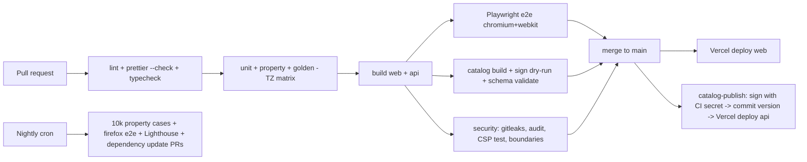

# 06 - Testing, CI, and Cost

## 1. Test strategy (pyramid weighted to the reminder and grouping core)

| Layer                                | Tooling                                                                                                                                                                          | Scope                                                                                                                                                                                                                                                                                                                                                                                            | Gate                                                                                                                                                                                                                                          |
| ------------------------------------ | -------------------------------------------------------------------------------------------------------------------------------------------------------------------------------- | ------------------------------------------------------------------------------------------------------------------------------------------------------------------------------------------------------------------------------------------------------------------------------------------------------------------------------------------------------------------------------------------------ | --------------------------------------------------------------------------------------------------------------------------------------------------------------------------------------------------------------------------------------------- |
| Unit (core)                          | Vitest, `TZ` matrix (UTC, Asia/Kolkata, America/Los_Angeles)                                                                                                                     | money (paise parse/format), civil dates, business calendar, **grouping engine**, **reminder planner**, ICS generator, escalation/snooze/markPaid transitions, deeplink resolver, spend aggregator, catalog signature verification                                                                                                                                                                | 95% line / 90% branch on `packages/core`; mutation testing (Stryker) on grouping + reminders at M1 exit, threshold 80%                                                                                                                        |
| Property-based                       | fast-check (arbitraries in `packages/testkit`)                                                                                                                                   | the 15 properties in `03` section 8; plus reminder properties: plan idempotence, `itemId` stability, items never in the past relative to `now`, no item for paid bills, sorted output, snooze never exceeds due-day cap, `diff(plan, plan)` empty                                                                                                                                                | run 500 cases in PR, 10,000 nightly with seed logging                                                                                                                                                                                         |
| Golden files                         | Vitest snapshots (reviewed in PRs)                                                                                                                                               | **ICS output** for the 6 worked examples (byte-for-byte, CRLF), notification payloads, signed catalog envelope; parser outputs                                                                                                                                                                                                                                                                   | Any diff needs explicit approval                                                                                                                                                                                                              |
| Parser golden (optional plugins, M2) | Synthetic `TextDocument` JSON fixtures + a few generated PDFs                                                                                                                    | Per issuer: happy path, layout drift, missing fields, wrong password, multi-card, scanned image                                                                                                                                                                                                                                                                                                  | **Synthetic statements only** (`pdf-lib` generator in `testkit` produces issuer-like layouts with fake names/numbers/amounts); never commit real statements; CI scan rejects Luhn-valid 13-19 digit numbers and flags personal-looking tokens |
| Vault                                | Vitest + `fake-indexeddb` + Node WebCrypto                                                                                                                                       | encrypt/decrypt round trip, AAD swap detection, tamper detection, wrong passphrase, slot rewrap, migrations from every previous fixture DB, backup export/import, crypto-erase                                                                                                                                                                                                                   | In CI                                                                                                                                                                                                                                         |
| Component                            | Vitest + Testing Library                                                                                                                                                         | key screens against `ui-contracts` view models (UI-library-agnostic)                                                                                                                                                                                                                                                                                                                             |                                                                                                                                                                                                                                               |
| E2E                                  | Playwright (Chromium, WebKit, Firefox; mobile viewport) with its clock API (`page.clock`)                                                                                        | onboarding -> add 3 cards via the 2-step flow -> see grouped day -> export ICS -> advance clock -> banner appears -> snooze -> mark paid (enter an amount once, Skip once) -> reminders suppressed -> dashboard shows only the logged amount; offline mode; backup/restore; locked vault; install prompt; SW notification via `context.grantPermissions(['notifications'])` and a simulated tick | Chromium+WebKit on PR, all three nightly                                                                                                                                                                                                      |
| Notification limits                  | Manual device matrix checklist (Android Chrome installed, iOS 17+/18+ Home Screen, desktop Chrome) each release                                                                  | Cannot be automated reliably                                                                                                                                                                                                                                                                                                                                                                     | Release checklist                                                                                                                                                                                                                             |
| A11y / perf / PWA                    | axe via Playwright, Lighthouse CI (PWA installability, perf budget: JS < 250 KB gz initial)                                                                                      |                                                                                                                                                                                                                                                                                                                                                                                                  | PR warning, release gate                                                                                                                                                                                                                      |
| Privacy invariants                   | Vitest                                                                                                                                                                           | reminder text, notification payloads and `.ics` output contain no digits-with-currency pattern (no amount) for any input; grouping output is identical when amounts vary (engine never receives them); `Payment` with `amountPaise=null` does not change aggregates; the deeplink path never calls `navigator.clipboard`                                                                         | Required                                                                                                                                                                                                                                      |
| Security                             | gitleaks, `pnpm audit`, CSP check (Playwright asserts no CSP violations and no requests to origins other than self + api), ESLint security plugin, dependency-cruiser boundaries | Also a test asserting the app makes **zero** network requests carrying user data (request inspector in E2E)                                                                                                                                                                                                                                                                                      | Required                                                                                                                                                                                                                                      |
| Contract                             | zod schemas from `packages/catalog` validate every JSON file in CI; API route snapshot tests (headers: ETag, Cache-Control)                                                      |                                                                                                                                                                                                                                                                                                                                                                                                  | Required                                                                                                                                                                                                                                      |

Time is always injected (`Clock`); core code is linted against `Date.now()`/`new Date()`.

## 2. CI on GitHub Actions (free tier)

- Public repo recommended: unlimited Actions minutes on standard runners. If private: 2,000 min/month free; the pipeline below is ~8-12 min per PR (Playwright dominates), so ~150+ PRs/month fit. Concurrency groups cancel superseded runs; Turborepo local cache + `actions/cache` for pnpm store and Playwright browsers.

Workflows: `ci.yml` (PR), `e2e.yml` (nightly + manual), `catalog-publish.yml` (on changes under `packages/catalog/**`; signs with `CATALOG_SIGNING_KEY` secret; the signature never exists in the repo). Deploys use Vercel's Git integration (free) rather than Actions; preview deploys per PR. Branch protection requires CI green. Lint: ESLint 9 flat config with `eslint-config-airbnb-extended` + typescript-eslint + Prettier check (decision and fallback in `00` section 8).

## 3. Cost table (target: $0 recurring, $0 upfront)

| Item                       | Service                                 | Plan               | Usage estimate                                                                                                            | Cost              |
| -------------------------- | --------------------------------------- | ------------------ | ------------------------------------------------------------------------------------------------------------------------- | ----------------- |
| Web hosting (static PWA)   | Vercel                                  | **Hobby**          | Static export, a few hundred KB per visitor first load, then cached by SW                                                 | $0                |
| Catalog API                | Vercel (second project)                 | Hobby              | `force-static` GET JSON, ~150 KB gz total, cached; no function invocations                                                | $0                |
| Domain                     | `*.vercel.app`                          | n/a                | custom domain optional (~INR 800/yr), **not required**, excluded                                                          | $0                |
| CI/CD                      | GitHub Actions                          | Free (public repo) | see above                                                                                                                 | $0                |
| Source hosting             | GitHub                                  | Free               |                                                                                                                           | $0                |
| Dependency updates         | Renovate (GitHub app) or Dependabot     | Free               |                                                                                                                           | $0                |
| Monorepo build             | pnpm + Turborepo, local cache           | OSS                | no remote cache                                                                                                           | $0                |
| Database / storage         | none (IndexedDB on the user's device)   | n/a                |                                                                                                                           | $0                |
| Auth                       | none                                    | n/a                |                                                                                                                           | $0                |
| Analytics / error tracking | none                                    | n/a                |                                                                                                                           | $0                |
| Email / SMS / push         | none (calendar + local notifications)   | n/a                | optional relay is an open question and, if built, must also fit a free tier                                               | $0                |
| Gmail API                  | Google Cloud project                    | Free API quota     | post-v1; **verification/CASA for restricted scope is a paid risk** (see `05` section 4); Testing mode (<=100 users) is $0 | $0 (risk flagged) |
| Drive appDataFolder        | Google                                  | Free               | later                                                                                                                     | $0                |
| Signing key                | Ed25519 key in GitHub secret            | Free               |                                                                                                                           | $0                |
| Tests / fonts / icons      | OSS, system font stack, self-hosted SVG | Free               |                                                                                                                           | $0                |
| Play Store TWA (optional)  | Google Play                             | one-time US$25     | not planned                                                                                                               | excluded          |

**Proof of $0**: no component stores or computes per-user server-side; every server artifact is a static file served from a CDN edge cache; all per-user work (storage, crypto, planning, notifications) executes on user devices. The only variable cost driver is static bandwidth: at ~300 KB first load and ~150 KB catalog per refresh, Vercel Hobby's fast-transfer allowance (ASSUMPTION: about 100 GB/month) supports on the order of 300,000 first loads per month, and caching reduces repeat transfer further. If limits are exceeded, Vercel pauses the project (does not bill Hobby); the fallback is the Cloudflare Pages move below.

## 4. Licence caveat and upgrade/migration path (manager decision: Vercel Hobby)

- **Vercel Hobby is restricted to personal, non-commercial use under Vercel's terms.** A free, ad-free, donation-free hobby/open-source app fits; the moment the app is monetised (ads, subscriptions, paid features, sponsorship tied to the product, or operated by a company), Hobby is no longer permitted.
- Path A (stay $0): migrate to **Cloudflare Pages** (static hosting, free, commercial use allowed). Steps: generate `_headers` (CSP/cache) from the same source as `vercel.json`; deploy `apps/web` static export; deploy the API as a static JSON export (route handlers are `force-static`, so a build-time dump to `/api/v1/**/*.json` is mechanical) or via the OpenNext Cloudflare adapter; update the `connect-src` and API base URL in one config; DNS cutover; old origin keeps serving until installed PWAs update (the catalog `/keys` and manifest remain at stable paths).
- Path B (paid): upgrade to Vercel Pro per seat. Breaks the $0 rule; needs manager approval.
- Triggers to act: any monetisation decision, an incorporated entity operating it, or hitting Hobby limits. Tracked as Q6 in `07`.
- Keep portability: no Vercel-specific runtime APIs (no Edge Config, KV, Analytics, Speed Insights, Image Optimization; `images.unoptimized = true`).
